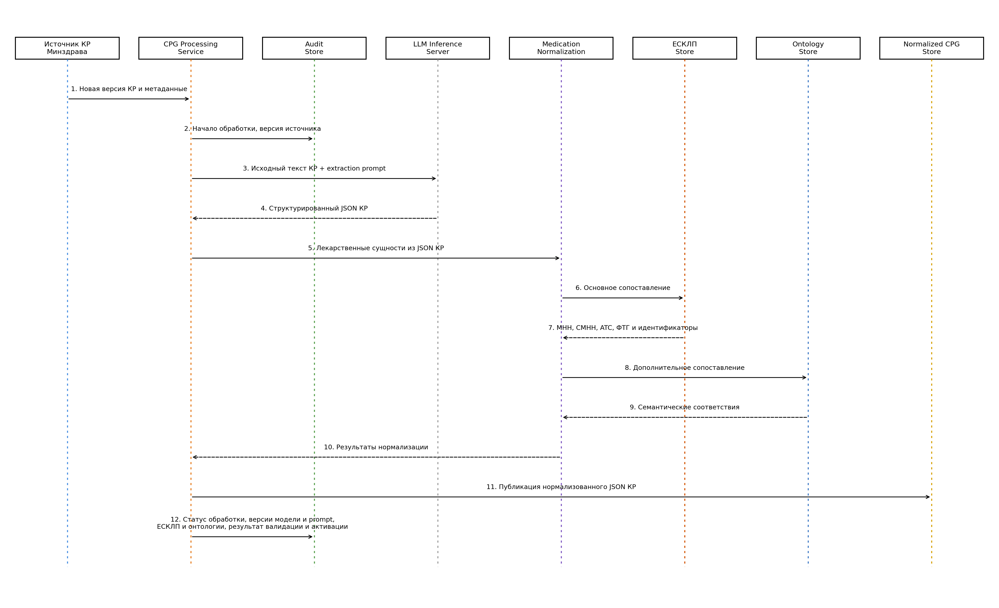
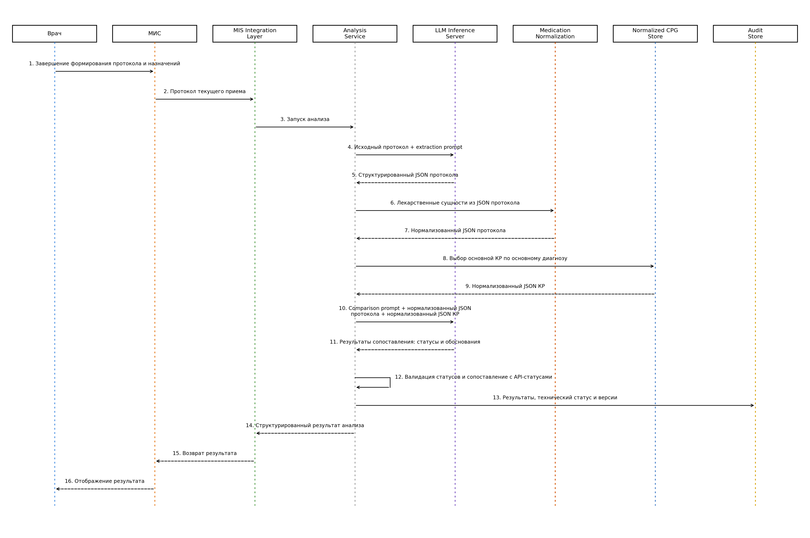
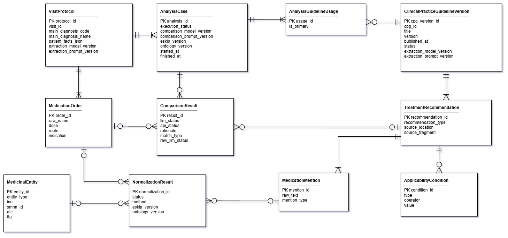
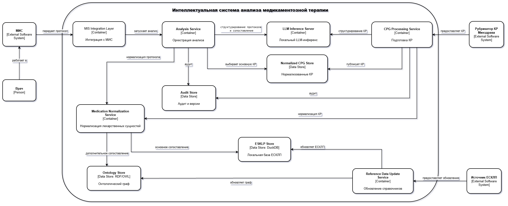
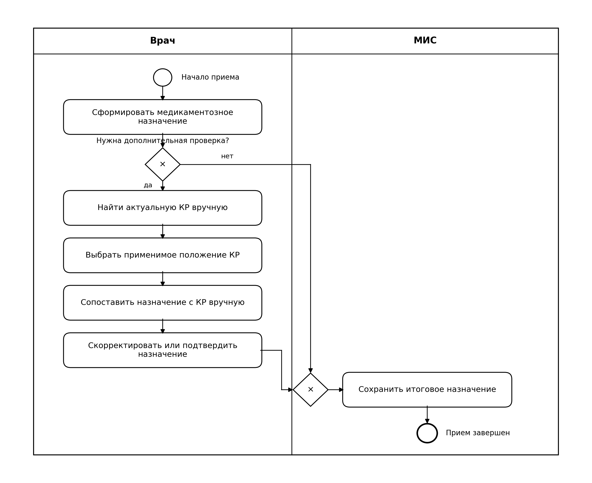
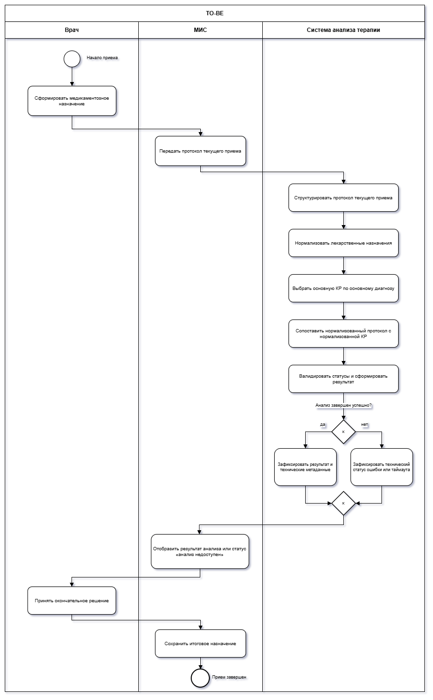

# ЛР 3 — проектирование

**Тема ВКР:** «Разработка интеллектуальной системы анализа медикаментозной терапии на основе клинических рекомендаций»

**Автор или участники команды:** Дедкова Анастасия Викторовна, К3440

**Вклад каждого участника при командной работе:** работа выполнена индивидуально.

## 1. Предметная область и требования

### Описание предметной области

Разрабатываемая система предназначена для автоматизированного анализа медикаментозной терапии, сформированной врачом в рамках текущего медицинского приема. Система сопоставляет назначения с актуальной клинической рекомендацией Минздрава России, выявляет потенциальные несоответствия и возвращает врачу объяснимый результат. Система не изменяет терапию автоматически и не принимает клиническое решение вместо врача.

В проекте разделены два контура обработки. В фоновом контуре клинические рекомендации заранее получают из официального источника, структурируют с помощью локальной большой языковой модели, нормализуют лекарственные упоминания и сохраняют в подготовленном виде. В онлайн-контуре МИС передает протокол текущего приема, после чего протокол структурируется, лекарственные назначения нормализуются, по основному диагнозу выбирается клиническая рекомендация и выполняется итоговое сопоставление.

В русскоязычном тексте используется сокращение «КР» – клиническая рекомендация. В технических англоязычных именах компонентов и сущностей используется обозначение CPG (Clinical Practice Guideline). Оба обозначения относятся к одному виду нормативно-клинического документа.

LLM используется для двух задач: извлечения структуры из исходного текста КР и врачебного протокола, а также для итогового семантического сопоставления уже нормализованных данных. Нормализация лекарственных сущностей выполняется без участия LLM: основным источником служит локальный ЕСКЛП в DuckDB, а онтологический граф применяется как дополнительный слой сопоставления.

### Функциональные требования

Функциональные требования определяют полный путь данных от получения протокола и подготовки КР до формирования объяснимого результата и технического аудита. Для каждого требования указано, каким способом его можно проверить.

| ID | Требование | Как проверить выполнение |
|---|---|---|
| FR-01 | Получать из МИС протокол текущего приема с основным диагнозом, клиническими фактами пациента и медикаментозными назначениями. | Интеграционный тест с тестовым протоколом и проверкой обязательных полей. |
| FR-02 | Получать и обновлять КР из официального источника с фиксацией идентификатора, версии и даты публикации. | Сверка метаданных локальной версии с официальным источником. |
| FR-03 | Преобразовывать исходный текст КР в структурированный JSON с помощью LLM и сохранять привязку к исходным фрагментам. | Проверка структуры JSON и ссылок на исходные положения КР. |
| FR-04 | Преобразовывать врачебный протокол в структурированный JSON с помощью LLM, извлекая основной диагноз, факты пациента и назначения. | Сравнение извлеченных полей с эталонными протоколами. |
| FR-05 | Нормализовать лекарственные сущности КР и протокола через ЕСКЛП, используя онтологию как дополнительный слой сопоставления. | Тесты на МНН, торговые наименования, ФТГ и неоднозначные формулировки. |
| FR-06 | Выбирать активную нормализованную КР по основному диагнозу пациента. | Проверка выбора КР для набора диагнозов и версий документов. |
| FR-07 | Передавать в LLM comparison prompt, нормализованные JSON протокола и КР для получения структурированных результатов сопоставления. | Интеграционный тест итогового вызова без передачи исходных текстов. |
| FR-08 | Валидировать LLM-статусы и детерминированно преобразовывать их в API-статусы; неизвестный статус сохранять и обрабатывать как WARNING. | Модульные тесты всех допустимых и неизвестных статусов. |
| FR-09 | Формировать объяснимый результат по каждому сопоставлению и возвращать его в МИС без автоматического изменения терапии. | Проверка ответа МИС и отсутствия операций автоматической коррекции назначения. |
| FR-10 | Вести технический аудит анализа, включая технический статус, версии модели, prompt, КР, ЕСКЛП, онтологии и результаты сравнения. | Проверка полноты записей аудита для завершенного и аварийного сценариев. |

### Нефункциональные требования

Нефункциональные требования задают ограничения по производительности, воспроизводимости, безопасности, отказоустойчивости, актуальности данных и модульности. Они учитываются одновременно в архитектуре, последовательностях взаимодействия и процессе TO-BE.

| ID | Требование | Как проверить выполнение |
|---|---|---|
| NFR-01 | Для типового случая p95 времени анализа на целевом локальном стенде не должен превышать 120 с; жесткий таймаут – 180 с. | Нагрузочный тест и расчет p95; отдельная проверка сценария таймаута. |
| NFR-02 | Результат должен быть связан с использованной версией КР и, когда применимо, с конкретной рекомендацией; фиксируются версии модели, prompt и справочных данных. | Повторный анализ по сохраненным версиям и аудит связей результата. |
| NFR-03 | Обрабатываются только необходимые данные текущего приема; LLM-инференс выполняется локально; система не изменяет терапию автоматически. | Анализ потоков данных, конфигурации развертывания и прав доступа. |
| NFR-04 | Недоступность LLM, нормализации, хранилища КР или превышение таймаута не должны блокировать МИС и завершение приема. | Тесты отказов зависимостей и контролируемого ответа «анализ недоступен». |
| NFR-05 | КР активируется после успешного структурирования, нормализации и валидации; ЕСКЛП и онтология обновляются не реже одного раза в месяц; предыдущие версии сохраняются. | Проверка жизненного цикла версий и воспроизводимости старого анализа. |
| NFR-06 | Интеграция, подготовка КР, нормализация, анализ, LLM-инференс, обновление справочников и аудит разделены по ответственности. | Архитектурная проверка границ компонентов и зависимостей. |

## 2. Обзор нотаций и видов диаграмм

Для описания проектируемой системы рассмотрены процессные, структурные и архитектурные нотации. Сравнение необходимо, поскольку одна диаграмма не позволяет одновременно показать бизнес-процесс врача, структуру данных, временной порядок взаимодействий и границы программных компонентов.

| Нотация или вид диаграммы | Что описывает | Сильные стороны |
|---|---|---|
| BPMN | Бизнес-процессы, роли, события и развилки. | Хорошо показывает AS-IS и TO-BE, ответственность участников и исключения. |
| UML-диаграмма последовательности | Временной порядок сообщений между участниками. | Наглядно фиксирует два LLM-вызова, нормализацию, выбор КР и аудит. |
| ER-модель данных | Сущности данных, атрибуты и кардинальности. | Подходит для версионирования, трассируемости и связи результатов с КР. |
| C4 | Архитектурные уровни и программные границы. | Показывает контейнеры, внешние системы, хранилища и зависимости. |
| UML-диаграмма классов | Классы, атрибуты, операции и связи объектов. | Полезна при проектировании объектной реализации. |
| UML-диаграмма активности | Последовательность действий и ветвления. | Подходит для алгоритмического процесса. |
| IDEF0 | Функции, входы, управление, механизмы и выходы. | Удобна для функциональной декомпозиции. |
| DFD | Потоки данных, процессы и хранилища. | Наглядно показывает движение данных. |

## 3. Выбор нотаций для проекта

Для проекта выбраны четыре взаимодополняющие нотации: BPMN, ER-модель данных, UML-диаграмма последовательности и C4. Каждая из них отвечает на отдельный проектный вопрос, поэтому модели не дублируют друг друга, а образуют согласованный набор представлений.

| Нотация или вид диаграммы | Что моделируем | Связанные требования | Почему подходит |
|---|---|---|---|
| BPMN | Процессы AS-IS и TO-BE. | FR-01, FR-02, FR-04–FR-10; NFR-01, NFR-02, NFR-04, NFR-05. | Показывает место автоматизированного анализа между формированием назначения и окончательным решением врача. |
| UML-диаграмма последовательности | Подготовка КР и онлайн-анализ протокола. | FR-01–FR-10; NFR-01, NFR-02, NFR-04–NFR-06. | Фиксирует фактический порядок вызовов LLM, нормализации, хранилищ и аудита. |
| ER-модель данных | Логическая структура данных. | FR-03, FR-04, FR-05, FR-06, FR-08, FR-09, FR-10; NFR-02, NFR-05. | Проверяет наличие сущностей и связей для нормализации, версионирования и трассируемости. |
| C4 | Контейнерная архитектура. | FR-01–FR-10; NFR-01–NFR-06. | Связывает функции с программными границами, внешними системами, хранилищами и нефункциональными требованиями. |

## 4. Модели системы

### UML-диаграмма последовательности подготовки и нормализации КР

**Диаграмма:**

*Рисунок 1 – UML-диаграмма последовательности подготовки и нормализации КР*

**Пояснение модели:** модель показывает фоновый контур подготовки КР до ее использования при анализе конкретного приема. CPG Processing Service получает исходный документ, передает его в LLM Inference Server для структурирования, после чего лекарственные упоминания из структурированного JSON направляются в Medication Normalization Service. ЕСКЛП используется как основной источник сопоставления, а онтологический граф – как дополнительный слой. После нормализации и валидации подготовленная версия публикуется в Normalized CPG Store, а сведения о ходе обработки фиксируются в Audit Store.

**Отраженные функциональные требования и элементы модели:** FR-02 отражено получением КР и ее метаданных из официального источника; FR-03 – вызовом LLM для преобразования исходного текста в структурированный JSON; FR-05 – обращением Medication Normalization Service к ESKLP Store и Ontology Store; FR-10 – записью статуса обработки и используемых версий в Audit Store.

**Нефункциональные требования и проектные решения:** NFR-02 обеспечивается фиксацией версий КР, модели, prompt, ЕСКЛП и онтологии; NFR-05 – раздельным хранением версий и публикацией КР только после успешной подготовки; NFR-06 – разделением ответственности между сервисом подготовки КР, LLM-инференсом, нормализацией, хранилищами и аудитом.

### UML-диаграмма последовательности обработки протокола и анализа назначения

**Диаграмма:**

*Рисунок 2 – UML-диаграмма последовательности обработки протокола и анализа назначения*

**Пояснение модели:** модель показывает онлайн-сценарий от завершения врачом протокола до возврата результата в МИС. MIS Integration Layer передает запрос в Analysis Service. Первый вызов LLM структурирует протокол, затем лекарственные назначения нормализуются. По основному диагнозу выбирается подготовленная КР. Второй вызов LLM получает comparison prompt, нормализованный JSON протокола и нормализованный JSON КР. После ответа LLM Analysis Service валидирует статусы, формирует API-результат, сохраняет аудит и возвращает результат через интеграционный слой.

**Отраженные функциональные требования и элементы модели:** FR-01 отражено передачей протокола из МИС; FR-04 – первым вызовом LLM для структурирования протокола; FR-05 – обращением к Medication Normalization; FR-06 – выбором КР из Normalized CPG Store; FR-07 – итоговым вызовом LLM с нормализованными JSON; FR-08 – шагом валидации и преобразования статусов; FR-09 – возвратом объяснимого результата в МИС без автоматического изменения терапии; FR-10 – записью результатов и версий в Audit Store.

**Нефункциональные требования и проектные решения:** NFR-01 относится ко всему интервалу онлайн-анализа от запуска запроса до возврата результата; NFR-02 обеспечивается записью использованных версий и результатов в Audit Store; NFR-04 поддерживается тем, что интеграция с МИС отделена от внутреннего контура анализа.

### ER-модель данных в нотации Crow’s Foot

**Диаграмма:**

*Рисунок 3 – ER-модель данных в нотации Crow’s Foot*

**Пояснение модели:** ER-модель данных описывает логические сущности, необходимые для хранения структурированного протокола, подготовленных версий КР, результатов нормализации, запусков анализа и отдельных результатов сопоставления. VisitProtocol связан с MedicationOrder и AnalysisCase; MedicationOrder и MedicationMention используют общий механизм NormalizationResult; ClinicalPracticeGuidelineVersion содержит атомарные TreatmentRecommendation; ComparisonResult хранит отдельный результат анализа без агрегирования клинических статусов на уровне AnalysisCase.

**Отраженные функциональные требования и элементы модели:** FR-03 отражено сущностями ClinicalPracticeGuidelineVersion, TreatmentRecommendation и MedicationMention; FR-04 – VisitProtocol и MedicationOrder; FR-05 – NormalizationResult и MedicinalEntity; FR-06 – AnalysisGuidelineUsage и признаком is_primary; FR-08 – полями llm_status, api_status и raw_llm_status в ComparisonResult; FR-09 – полями rationale и связями результата с назначением и рекомендацией; FR-10 – AnalysisCase, временными метками и версиями модели и справочных данных.

**Нефункциональные требования и проектные решения:** NFR-02 обеспечивается сохранением версий, временных меток и связей результата с конкретными данными анализа; NFR-05 – отдельным учетом версий КР, ЕСКЛП и онтологии, что позволяет воспроизводить ранее выполненные анализы после обновления справочных данных.

### C4-модель контейнеров

**Диаграмма:**

*Рисунок 4 – C4-модель контейнеров интеллектуальной системы анализа медикаментозной терапии*

**Пояснение модели:** C4-модель фиксирует статическую архитектуру и границу разрабатываемой системы. Внешними участниками являются врач, МИС, официальный источник КР и источник ЕСКЛП. MIS Integration Layer отвечает за обмен с МИС, Analysis Service – за оркестрацию онлайн-анализа, CPG Processing Service – за подготовку КР, Medication Normalization Service – за общую нормализацию лекарственных сущностей, Reference Data Update Service – за обновление справочных данных. LLM Inference Server используется только вызывающими сервисами и не обращается к хранилищам напрямую.

**Отраженные функциональные требования и элементы модели:** FR-01 связан с MIS Integration Layer; FR-02 и FR-03 – с CPG Processing Service и LLM Inference Server; FR-04 – с Analysis Service и LLM Inference Server; FR-05 – с Medication Normalization Service, ESKLP Store и Ontology Store; FR-06 – с Analysis Service и Normalized CPG Store; FR-07 и FR-08 – с Analysis Service и LLM Inference Server; FR-09 – с контуром возврата результата через интеграционный слой; FR-10 – с Audit Store. Таким образом, C4-модель покрывает FR-01–FR-10.

**Нефункциональные требования и проектные решения:** NFR-01 относится к онлайн-контуру Analysis Service; NFR-02 поддерживается Audit Store и версионированными хранилищами; NFR-03 – локальным LLM-инференсом и ограниченным интеграционным слоем; NFR-04 – разделением внешней интеграции и внутренних зависимостей; NFR-05 – отдельными хранилищами КР и справочных данных и сервисом их обновления; NFR-06 – явным разделением контейнеров по ответственности. Следовательно, модель отражает NFR-01–NFR-06.

## 5. AS-IS и TO-BE

**Выбранная нотация:** BPMN

### AS-IS – текущее состояние

**Диаграмма:**

*Рисунок 5 – BPMN-модель процесса AS-IS*

**Описание и ограничения:** после формирования медикаментозного назначения дополнительная проверка выполняется врачом вручную и, как правило, только при возникновении сомнений. При необходимости врач самостоятельно ищет актуальную КР, выбирает применимое положение, сопоставляет его с назначением и затем подтверждает или корректирует назначение.

Основные ограничения процесса – несистематичность проверки, ручной контроль актуальности КР, отсутствие нормализации различных форм лекарственных наименований и отсутствие отдельного машиночитаемого следа проверки. Они обосновывают FR-02, FR-05–FR-10, а также NFR-02 и NFR-05. При этом переход к автоматизированному процессу не должен создавать новую критическую зависимость для МИС: недоступность анализа не должна препятствовать завершению приема, что соответствует NFR-04.

### TO-BE – предлагаемое состояние

**Диаграмма:**

*Рисунок 6 – BPMN-модель процесса TO-BE*

**Описание изменений:** в целевом процессе после формирования назначения МИС передает протокол текущего приема в систему анализа. Система структурирует протокол, нормализует лекарственные назначения, выбирает КР по основному диагнозу, сопоставляет нормализованный протокол с нормализованной КР и валидирует полученные статусы. После проверки успешности анализа результат и технические метаданные фиксируются, а при ошибке или таймауте сохраняется контролируемый технический статус. Обе ветки возвращаются в МИС, где отображается либо результат анализа, либо сообщение о недоступности анализа. Затем врач принимает окончательное решение, после чего итоговое назначение сохраняется.

Диаграмма TO-BE отражает функциональные требования, связанные с онлайн-анализом врачебного протокола. FR-01 представлено передачей протокола текущего приема из МИС в систему анализа. FR-04 отражено этапом «Структурировать протокол текущего приема», на котором из входного протокола выделяются основной диагноз, клинические факты и медикаментозные назначения. FR-05 представлено этапом «Нормализовать лекарственные назначения», обеспечивающим приведение лекарственных сущностей к единому представлению. FR-06 отражено выбором КР по основному диагнозу. FR-07 представлено этапом сопоставления нормализованного протокола с нормализованной КР. FR-08 отражено отдельным этапом валидации полученных статусов и формирования результата. FR-09 проявляется в передаче сформированного результата в МИС и его отображении врачу без автоматического изменения назначения. FR-10 отражено фиксацией результата анализа и технических метаданных.

Нефункциональные требования и проектные решения: NFR-01 отражается наличием контролируемого сценария завершения анализа при превышении допустимого времени выполнения. NFR-02 обеспечивается этапом фиксации результата и технических метаданных, необходимым для последующей трассируемости и воспроизводимости анализа. NFR-04 отражено отдельной веткой технической ошибки или таймаута: при невозможности получить результат МИС отображает статус «анализ недоступен», после чего управление возвращается врачу и прием может быть завершен без результата автоматизированного анализа.

### Обоснование перехода

Переход от AS-IS к TO-BE заключается в замене эпизодической ручной проверки назначения врачом на встроенный в процесс автоматизированный анализ, выполняемый для каждого переданного протокола. На схеме TO-BE улучшение видно по появлению отдельной дорожки системы анализа, последовательных этапов структурирования, нормализации, выбора КР, сопоставления и валидации, а также по отдельной ветке технического отказа. При этом окончательное решение остается в дорожке врача, поэтому автоматизация не подменяет медицинскую экспертизу.

| Аспект | AS-IS | TO-BE | Связанные требования |
|---|---|---|---|
| Получение данных | Врач работает с данными приема вручную. | МИС передает системе ограниченный протокол текущего приема. | FR-01; NFR-03 |
| Работа с КР | Ручной поиск актуального документа. | Используется заранее подготовленная активная версия КР. | FR-02, FR-03, FR-06; NFR-05 |
| Сопоставление лекарств | Ручное строковое и смысловое сопоставление. | Нормализация через ЕСКЛП и дополнительный онтологический слой. | FR-05 |
| Анализ назначения | Зависит от инициативы и доступного времени врача. | Систематическое LLM-сопоставление нормализованных данных. | FR-07, FR-08 |
| Объяснение результата | Отдельно не фиксируется. | Формируется объяснимый результат по каждому сопоставлению. | FR-09; NFR-02 |
| Аудит | Нет отдельного технического следа проверки. | Сохраняются результаты, технический статус и версии данных и моделей. | FR-10; NFR-02, NFR-05 |
| Технический отказ | Не применимо к внешнему анализу. | Ошибка или таймаут не блокируют МИС и решение врача. | NFR-01, NFR-04 |

Таким образом, решения TO-BE обеспечивают переход к воспроизводимой проверке на основе заранее подготовленных и версионированных КР, общей нормализации лекарственных сущностей, объяснимого результата и технического аудита. Отказоустойчивая ветка сохраняет работоспособность МИС при недоступности анализа, а финальное решение врача остается обязательным этапом процесса.

## 6. Выводы

Выбранные нотации адекватно отражают предметную область и цели ВКР, поскольку рассматривают проектируемую систему с четырех взаимодополняющих точек зрения. BPMN показывает изменение процесса работы врача при переходе от AS-IS к TO-BE, UML-диаграммы последовательности фиксируют порядок взаимодействий в фоновом и онлайн-контурах, ER-модель в нотации Crow’s Foot описывает структуру данных и кардинальности связей, а C4-модель связывает функции системы с программными компонентами, внешними системами и хранилищами.

Представленные модели подтверждают выполнение ключевых функциональных и нефункциональных требований. UML-диаграмма подготовки КР отражает получение, структурирование, нормализацию и версионирование КР; UML-диаграмма анализа протокола – прием данных из МИС, структурирование протокола, нормализацию назначений, выбор КР, сопоставление и формирование результата. ER-модель обеспечивает хранение версий, результатов нормализации, запусков анализа и отдельных результатов сопоставления, а C4-модель показывает архитектурное распределение всех основных функций и проектных ограничений. Таким образом обеспечивается трассируемость требований между процессами, данными и взаимодействиями компонентов.

Улучшение TO-BE по сравнению с AS-IS непосредственно видно на BPMN-диаграммах. В AS-IS дополнительная проверка зависит от решения врача, поиск актуальной КР и сопоставление выполняются вручную, а отдельный машиночитаемый результат проверки не формируется. В TO-BE после передачи протокола в процесс добавлены последовательные этапы структурирования, нормализации, выбора основной КР, автоматизированного сопоставления, валидации статусов и фиксации результата. Кроме того, предусмотрена отдельная ветка технической ошибки или таймаута, которая возвращает управление врачу и не препятствует завершению приема. Таким образом, проверка становится систематической, воспроизводимой и трассируемой, при этом окончательное клиническое решение остается за врачом.
